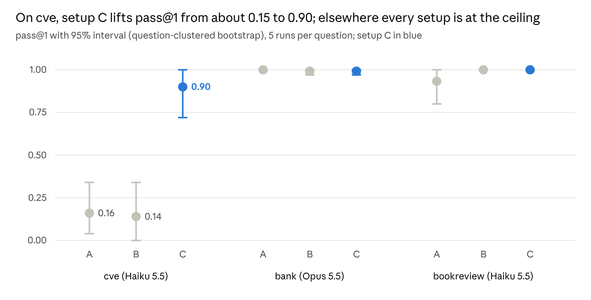

# Agent State Bench: Revised Report

**Version 0.1.0-draft, 2026-10-09. Work in progress:** numbers and conclusions may change before 1.0.

Agents that query Tapstate's consolidated state (setup C) used 3.4–12× fewer tokens (median per run) than agents stitching the raw sources together, on all three datasets. Accuracy rose only where the raw data is hard: on cve, Haiku 5.5 scored 0.90 pass@1 with setup C against 0.16 and 0.14 on the raw sources. On bank (Opus 5.5) and bookreview (Haiku 5.5) every setup is at or near the ceiling.

## Results

Setup C was the cheapest per correct answer on every dataset: about 3× cheaper than A on bank, 3× on bookreview and 50× on cve. Each row is one dataset and setup; 5 runs per question.

| Dataset | Model | Setup | Runs | Median tokens per run | Tokens vs C | Median turns | Total $ | $ per correct (95% CI) |
| --- | --- | --- | ---: | ---: | ---: | ---: | ---: | --- |
| cve | Haiku 5.5 | A | 50 | 912,273 | 8.7× | 27 | 2.78 | 0.348 (0.169–1.496) |
| cve | Haiku 5.5 | B | 50 | 1,302,789 | 12.4× | 29.5 | 5.63 | 0.804 (0.263–no upper bound) |
| cve | Haiku 5.5 | C | 50 | 105,449 | 1.0× | 9 | 0.31 | 0.007 (0.005–0.009) |
| bank | Opus 5.5 | A | 120 | 79,358 | 3.6× | 7 | 20.67 | 0.172 (0.135–0.210) |
| bank | Opus 5.5 | B | 120 | 74,508 | 3.4× | 7 | 19.23 | 0.162 (0.125–0.197) |
| bank | Opus 5.5 | C | 120 | 22,074 | 1.0× | 4 | 6.84 | 0.057 (0.048–0.068) |
| bookreview | Haiku 5.5 | A | 15 | 87,617 | 4.9× | 10 | 0.09 | 0.006 (0.005–0.008) |
| bookreview | Haiku 5.5 | B | 15 | 80,429 | 4.5× | 10 | 0.09 | 0.006 (0.005–0.007) |
| bookreview | Haiku 5.5 | C | 15 | 17,905 | 1.0× | 3 | 0.03 | 0.002 (0.001–0.003) |

Costs are Claude Code's API-equivalent estimates in USD, failed runs included. Models differ by dataset, so compare setups within a dataset, not datasets with each other.

*Source: `harness/score.py` over all runs in the DAB checkout, 2026-10-09 · 3 datasets × 3 setups.*

The intervals on cve A and B are wide because only 10 questions are resampled; setup C's interval does not overlap them.

## cve: resolved keys turn a failing task into a passing one

On cve, setup C scored 0.900 pass@1 (95% CI 0.72–1.00) against 0.160 for A and 0.140 for B. DAB's cve sources scramble the CVE join keys with prefixes, wrappers and 32 encodings. On the raw sources Haiku 5.5 spent about 1M tokens per run trying to match them, and mostly failed. Setup C won on 9 of 10 questions.

| Question | A pass | B pass | C pass | A median tokens | C median tokens |
| ---: | ---: | ---: | ---: | ---: | ---: |
| 1 | 1/5 | 0/5 | 5/5 | 1,976,214 | 117,107 |
| 2 | 1/5 | 0/5 | 4/5 | 438,936 | 188,501 |
| 3 | 0/5 | 0/5 | 5/5 | 975,216 | 97,487 |
| 4 | 0/5 | 0/5 | 5/5 | 928,251 | 85,668 |
| 5 | 4/5 | 5/5 | 1/5 | 773,369 | 126,916 |
| 6 | 2/5 | 1/5 | 5/5 | 1,395,140 | 88,432 |
| 7 | 0/5 | 0/5 | 5/5 | 984,193 | 16,643 |
| 8 | 0/5 | 0/5 | 5/5 | 973,453 | 118,725 |
| 9 | 0/5 | 1/5 | 5/5 | 587,679 | 52,112 |
| 10 | 0/5 | 0/5 | 5/5 | 617,039 | 123,108 |

Question 5 is the exception. It asks how many distinct Apache Tomcat versions the CPE match list records for CVEs in CISA's KEV catalog; the answer is 1.

- **Three runs misread it.** They kept only KEV entries whose own product is Tomcat, found no CPE versions for those, and answered 0. The question selects Tomcat through the CPE match list instead.
- **One run was correct but scored as a fail.** It answered "1. Only one KEV-listed CVE matches…", and DAB's validator does not accept a number followed by a period.

Setup C on cve uses an exact inverse of DAB's key-scrambling generator to build the crosswalk. It shows what perfectly resolved state is worth, not what a product resolver would reach.

## bank: same accuracy, about 3.5× fewer tokens

On bank, Opus 5.5 scored at the ceiling in every setup (A 1.000, B 0.992, C 0.992), so this pilot supports a cost claim but not an accuracy claim. The data is NPCI's tau-indian-banking dataset split into six source systems with their own key formats; setup C is one Tapstate-built document per customer, verified 944 of 944 against upstream. It has 24 questions.

| Question category | Questions | A median tokens | C median tokens | Tokens A vs C |
| --- | ---: | ---: | ---: | ---: |
| Single-source control | 4 | 20,961 | 20,830 | 1.0× |
| Two sources | 8 | 74,419 | 21,558 | 3.5× |
| Three or more sources | 8 | 88,900 | 24,498 | 3.6× |
| Portfolio totals | 4 | 100,268 | 43,271 | 2.3× |

- **The saving tracks the number of sources joined.** It is absent on the single-source controls, as designed.
- **Two failures in 360 runs** (question 14 in B, question 7 in C). Both agents wrote a correct answer but never called `return_answer`, which DAB counts as no answer.
- **Hints did not help.** B scored like A and used only about 5% fewer tokens; Opus found the key formats from the data itself.
- **Validator correction, disclosed.** The first scoring failed 26 correct answers through three validator defects; one of them hit A and B harder than C. The corrected validators (version 2) were applied identically to all setups. Before the fix, pass@1 was A 0.917, B 0.900, C 0.950.

Source: branch `claude/bank-dab-source-split`, commit `5b3bfc2` (SOURCE_SPLIT.md and dab/PILOT_RESULTS_opus.md).

## bookreview: ceiling accuracy, fewer turns

On bookreview, Haiku 5.5 scored 0.933 with A and 1.000 with B and C; the only miss was one A run on question 2. Setup C needed 3 turns per run instead of 10, and about 18K tokens instead of 80–88K. With 3 questions and 15 runs per setup, this is a small sample and mainly confirms that the setups behave as expected.

## How the runs were set up

Every setup used the same agent, tools, prompt and questions; only the data and its description changed.

| Setup | Data the agent queries | Guidance |
| --- | --- | --- |
| A | the raw source databases (Postgres, SQLite, DuckDB, MongoDB) | none |
| B | the same databases | DAB's hint files (bank: key-format hints) |
| C | one MongoDB database built by Tapstate pipelines from the same sources | a description of its fields and guarantees, no hints |

- **Agent:** Claude Code headless (`claude -p`), restricted to DAB's four tools: query a database, list tables, run Python, return an answer.
- **Questions and grading:** DAB at commit `0290945c2b38` with the kit's `dab.patch`; DAB's validators, or the bank pilot's own (version 2).
- **Runs:** 5 per question. cve used queries 1–10 and bookreview 1–3, both on Haiku 5.5 (`claude-haiku-5-5`); bank used all 24 on Opus 5.5.
- **Metrics:** pass@1 averaged per question, as DAB does; median tokens and turns; cost per correct answer (total spend, failed runs included, over correct runs); 95% intervals from a question-clustered bootstrap.
- **Tapstate:** built from the `main` branch (`9af4288`), because the tapstate/tapstate#526 fix is not yet in a release.

## Building setup C on Tapstate main

Setup C for cve now builds entirely in Tapstate, but the full load took about 3 hours on a 4-vCPU instance, even with MongoDB on a RAM disk. The cost is in how Tapstate stores join state.

| Problem | Effect | Fix | Where |
| --- | --- | --- | --- |
| The kit never created the per-table crosswalks (`xw_cves`, `xw_cpe_matches`, `xw_kev_entries`, `xw_cve_documents`) the cve pipelines join on | Pipelines failed with `source-table-not-discovered` | New `make_cve_crosswalks.py` builds them from `cve_xwalk`; every key resolves | kit, uncommitted |
| The cpe_match JS step declared its vendor-alias map (thousands of entries) inside `process()` | The map was rebuilt for every record | Moved constant maps to script scope; gone from thread dumps | kit, uncommitted |
| Join state is saved one document per call with write concern majority + journal | Each state write waited for a disk flush: about 7 ms median on EBS, about 290 writes/s | Benchmark workaround: MongoDB on a RAM disk (2 ms median, about 675 writes/s), copied back to disk afterwards | Tapstate engine |
| Dropping a pipeline's state filters on `_id.ns`, which the `_id` index cannot serve | Full collection scans of about 25K documents on every stop/restart | Added an index on `_id.ns` locally | Tapstate engine |
| cpe_match is a three-way join over about 1.7M source rows | The long pole of the load; CPU-bound once disk waits were gone | None; merging the row-aligned `cpe_version_details` into `cpe_matches` would cut about 40% of its state writes | dataset design |

Raising `batch_size` to 5000 and `parallelism` to 4 did not change throughput, so those were reverted. Two smaller kit fixes rode along: `mongodump` now runs as the calling user (committed for the small datasets, uncommitted for cve), and the bookreview source definitions the branch lacked were added (local commit `7372ced`).

## Limits to read the numbers with

- **cve setup C is an upper bound.** Its crosswalk comes from an exact inverse of DAB's scrambling generator, which no product resolver has.
- **One cve setup C fail is a validator false negative** (question 5, "1." followed by a period). Counting it as a pass moves setup C from 0.900 to 0.920.
- **Models differ by dataset.** Haiku 5.5 ran cve and bookreview, Opus 5.5 ran bank; numbers are comparable only within a dataset.
- **Samples are small.** bookreview has 3 questions and cve 10, so the A and B intervals on cve are wide (0.00–0.34).
- **Costs are estimates.** They are Claude Code's API-equivalent figures, not billed amounts. The scorer's new per-request Haiku 5.5 price tier applies only to API runs, so it does not change these numbers.
- **Some setup C fields were chosen after reading the questions** (noted in the kit's README); the bookreview check without its question-shaped field scored the same.
- **Freshness is not measured.** Every agent queried a fully loaded, static copy of setup C.

## Next steps

- [ ] Commit the kit fixes (`make_cve_crosswalks.py`, the hoisted JS maps, the cve `mongodump` user) and push branch `haiku-5-5-trial` for review.
- [ ] File two Tapstate issues: batch or make configurable the join-state writes, and index `_id.ns` in `operator_state`.
- [ ] Test accuracy on bank where it is not at the ceiling: a weaker model, or harder questions such as conflicting values between systems.
- [ ] Re-run cve with a second model to check that the setup C gain holds beyond Haiku 5.5.
- [ ] Measure freshness: how long setup C takes to reflect source changes.

## Version history

| Version | Date | Change |
| --- | --- | --- |
| 0.1.0-draft | 2026-10-09 | First combined report: Haiku 5.5 trial (cve, bookreview) and the bank pilot (Opus 5.5) |
